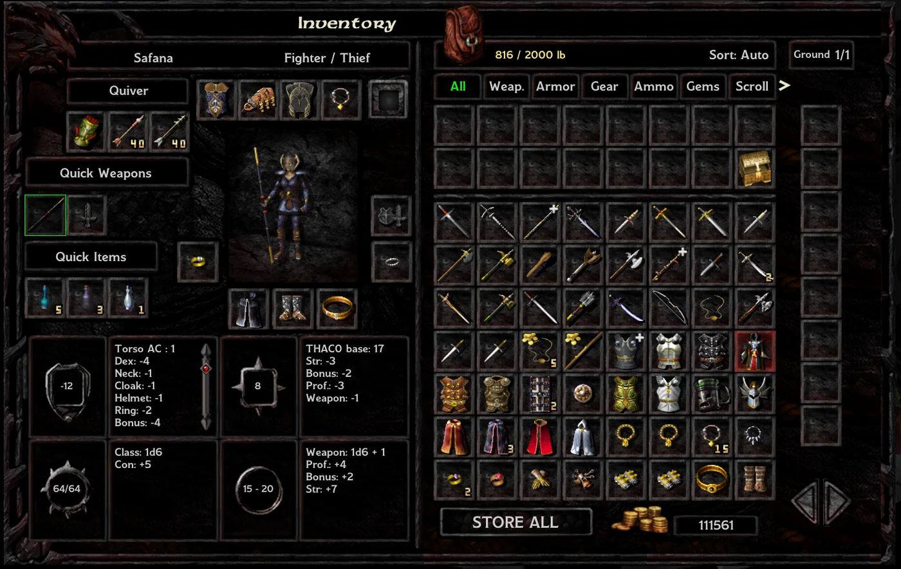
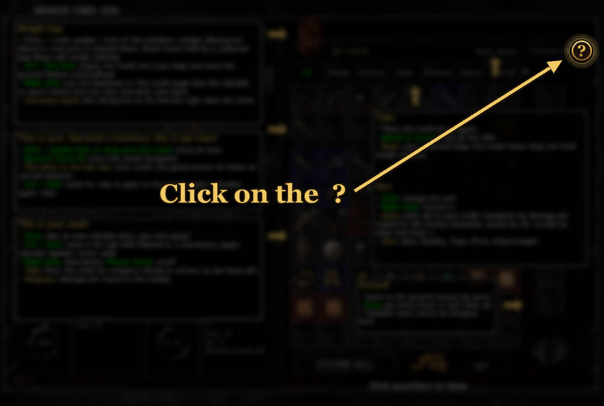
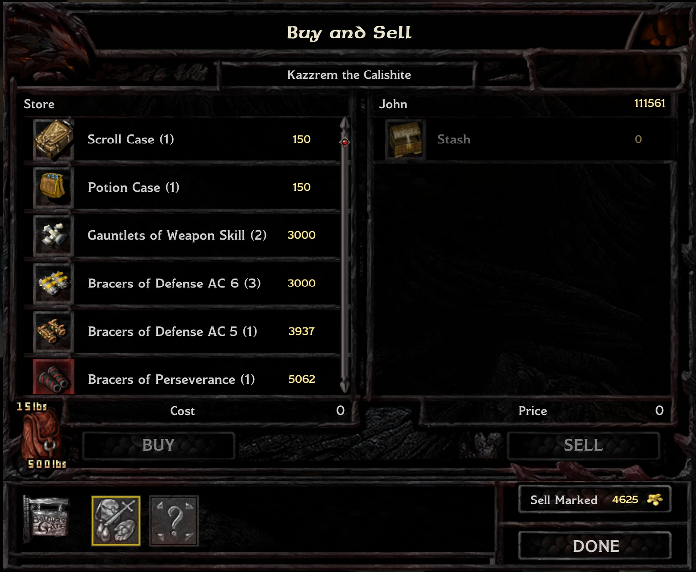
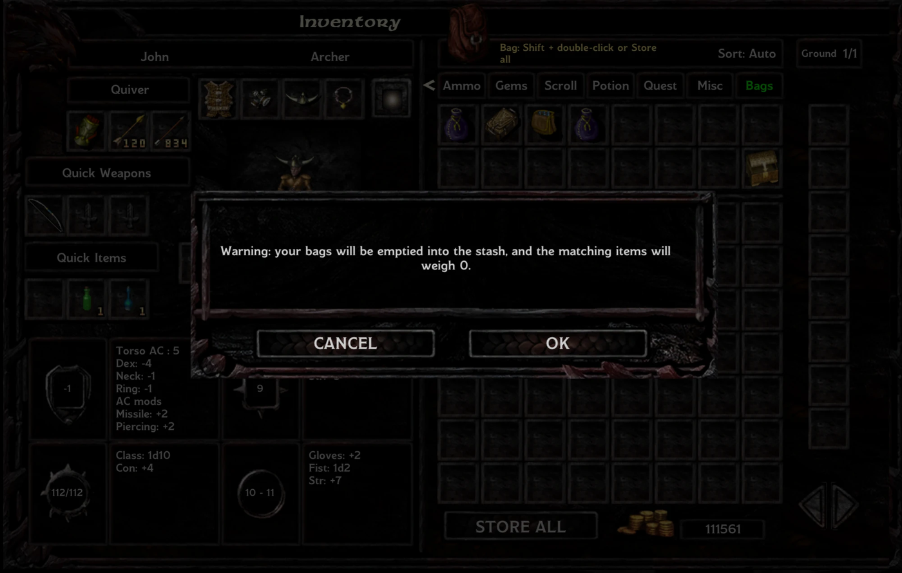
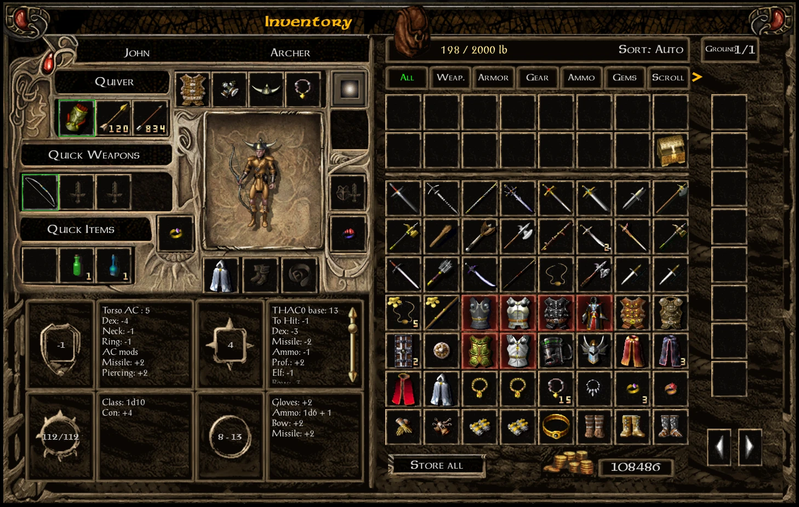
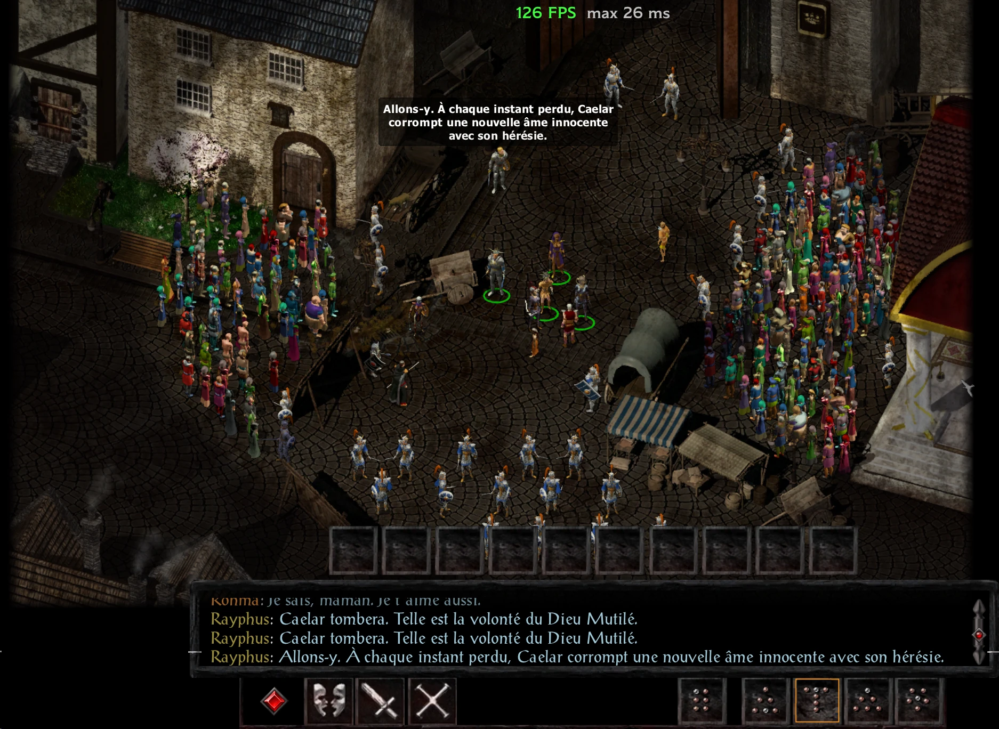

# Party Stash (BG:EE / SoD / BG2:EE)

 Questions, bug reports and test builds: [Sado Mods Discord](https://discord.gg/3XzeQv7HeS).

> **Party Stash is now part of [SadoEE](https://github.com/sad0/SadoEE)**: the same stash plus a bigger party (7-32 members, banters work), a rest camp and many QoL options, every part optional. Coming from Party Stash: uninstall it, then install SadoEE; your saves and stash contents are kept. Party Stash stays available here.

*[Version française plus bas](#français)*

One infinite stash shared by the whole party, **Pillars of Eternity** style, built into a redesigned inventory page.
A WeiDU mod for the Enhanced Editions, powered by [EEex](https://github.com/Bubb13/EEex).

## Features

### 

- Infinite and shared, right on the inventory page
- Quests still see the items you store
- Tabs and smart sorting (right-click the sort button to reverse it)

### 

- Damage per round and THAC0 in every weapon tooltip
- A **+** on the weapons that beat what you hold
- Charges shown on wands

### 

- **Ctrl + click**: for sale → valuable → clear
- **Sell Marked** sells all the junk at once, at any merchant
- Valuable items are never sold or dropped

### 

- Store a bag: it is emptied into the stash and its items weigh nothing
- A Bag of Holding makes the whole stash weightless
- The stash weighs against the whole party's allowance

### 

- Put your backpack or a stash page into any chest in one click

### 

- The gold **?** button explains every part of the page
- Baldur's Gate 1 or II look, LeUI and Infinity UI++ support
- Options: weightless stash, keep your gold through campaign changes, hardcore mode
- 15 languages

<b>All the details</b>

- **Shared stash**: every party member reaches the same infinite stash, right on the inventory page. Quests still
  see the items stored in it.
- **New inventory page**: your backpack and the stash in one scrollable grid, a ground column, and the stats shown
  as compact 2×2 blocks (attributes in 3 letters: Str, Dex, Con…).
- **Tabs**: All, Weapons, Armor, Gear, Ammo, Gems, Scrolls, Potions, Quest, Misc, Bags.
- **Smart sorting**: *Auto* (each tab has its own order: weapons by damage per round for the shown character, armor
  by AC, scrolls by class and level…), plus Date, Quality, Type, Price and Value/weight. **Right-click** the sort
  button to reverse it.
- **Colour hints**: red = unusable by the shown character, blue = unidentified, **+** = an upgrade for him (or a
  scroll a party mage can still learn).
- **Marks**: **Ctrl + click** an item (in the stash, the backpack or equipped) to mark it **for sale** (darkened),
  again to make it **valuable** (golden), again to clear it. **Sell Marked** sells everything marked for sale at once
  from any merchant, straight from the stash, with the total shown on the button.
- **Valuable items** are never sold, skipped by Store all and by the merchants' selection, and cannot be dropped on
  the ground. A backpack item marked for sale goes straight to the stash.
- **Damage per round**: weapon tooltips show the damage per round and THAC0 for the shown character (strength,
  proficiencies, attacks per round, both hands when dual-wielding); the stats show the attacks per round.
- **Charges**: wands and other charged items show their charges in the corner of their cell.
- **Help overlay**: the gold **?** button at the top right shows what each part of the page does.
- **Put away**: **right-click** the big bag next to the weight, then open a container, and choose to put the
  backpack or the shown stash page in it (valuable and quest items stay). The container panel has a button for it too.
- **Bags**: put a gem bag, scroll case, potion case… in the stash. It is emptied into the stash and kept in the Bags
  tab, and the stash items it can hold weigh nothing. A Bag of Holding makes the whole stash weightless.
- **Weight**: the stash counts against the sum of the members' weight allowances; above it, the party is slowed.
- **Two looks**: Baldur's Gate 1 or Baldur's Gate II style, on either game (the installer recommends the one
  matching your game).
- **Sorted loot** (optional component): ground piles, containers and the quick loot bar list quest items first,
  then weightless items, then the rest by value/weight.
- **Options** (optional components): the stash weighs nothing; keep the party gold through the campaign changes
  (BG1 to SoD, SoD to BG2 in EET); hardcore: those changes empty the stash too.
- **15 languages**: English, French, German, Spanish, Italian, Polish, Russian, Portuguese (Brazil), Czech,
  Hungarian, Turkish, Ukrainian, Simplified Chinese, Japanese, Korean.

## Requirements

- **Baldur's Gate: Enhanced Edition** (with or without **Siege of Dragonspear**), **Baldur's Gate II: Enhanced Edition**
  or **EET**, game version **v2.6.6** or **v2.7.x** (the mod calls the game engine directly; on another version the
  stash disables itself instead of crashing).
- **[EEex](https://github.com/Bubb13/EEex)**, installed first.
- **LeUI** works with Party Stash: install LeUI first, then pick the **Baldur's Gate II look** (see below).
- **Infinity UI++** works with Party Stash: install it first.
- Another mod that replaces the inventory screen (**Dragonspear UI++**…) will conflict with the new inventory page.

### With LeUI

Party Stash with the Baldur's Gate II look on top of **LeUI** (BG:EE):

## Installation

1. Install **EEex**.
2. Extract the archive into your game folder (where `chitin.key` is): you get a `PartyStash` folder and
   `setup-PartyStash.exe`.
3. Run `setup-PartyStash.exe`, pick your language, then:
   - **Party Stash**: choose the Baldur's Gate 1 or Baldur's Gate II look;
   - **Sorted loot**: optional;
   - **Options**: weightless stash, keep the gold through campaign changes, hardcore (optional).
4. Launch the game through `InfinityLoader.exe` (**EEex**).

## Controls (inventory page)

| Action | Control |
|---|---|
| Take an item from the stash | Click it (double-click: take and equip) |
| Store a backpack item | **Shift + double-click** it, or drop it on the stash grid |
| Store the whole backpack | **Store all** button, or **Space** |
| Mark for sale / valuable / clear | **Ctrl + click** an item (stash, backpack or equipped) |
| Item description | Right-click |
| Scroll the grid, the tabs, the ground | Mouse wheel, arrows |
| Help: what Party Stash adds to the page | The gold **?** button at the top right |
| Reverse the sort | **Right-click** the sort button |
| Put the backpack or a stash page in a container | **Right-click** the big bag, then open the container; or the red button at the bottom right of the container panel |
| Store a bag | **Shift + double-click** it, or Store all (asks first) |
| **Empty the stash** (before uninstalling) | **Ctrl + left click** on the big bag next to the weight |

## Uninstalling

**Empty the stash first**, in game: **Ctrl + left click** on the big bag next to the weight. Your collected bags
come back filled with the items they can hold; everything else drops on the ground. Then run
`setup-PartyStash.exe` and uninstall. If you skip this, the stash contents stay in your saves but cannot be reached
until the mod is reinstalled.

## FAQ

**How does sorting work?** Each tab has its own default sort (**Auto**: weapons by damage per round, armor by AC,
scrolls by class and level...), or you pick **Date**, **Quality**, **Type**, **Price** or **Value/weight**.

**What about bags, even bags of holding?** There is no nesting. A bag put in the stash is emptied into it and kept
in the **Bags** tab, so the stash stays one flat list. Each collected bag makes the stash items it could hold
weightless. A **bag of holding** covers every type, so with one the whole stash weighs nothing.

**I carry around every damn thing. Is that a problem?** The stash is infinite. Without a bag of holding, its weight
counts against the party's combined allowance (over it, everyone slows down). **Store all** empties a backpack in
one click, and **Sell Marked** sells everything you marked at any merchant in one go.

**Does it slow the game down?** No per-creature hooks (no opcode, script or action hooks): its work is throttled
(a quick check every 500 ms, the party weight every 2 s), so the number of creatures on screen doesn't change its
cost. Here is the Ducal Palace in **Siege of Dragonspear**, with hundreds of NPCs, still around 120+ FPS:

## Notes

- Moving from Baldur's Gate to **Siege of Dragonspear**: the stash is carried over as long as the game is not closed
  between the end of BG1 and the start of SoD.
- **EET** (Enhanced Edition Trilogy): tested on v2.6.6. The stash survives the move from **Siege of Dragonspear** to
  Baldur's Gate II.
- Translations other than English and French were made by the author: corrections are welcome (`PartyStash/tra/`).

## Download and discussion

- Download: [GitHub release](https://github.com/sad0/PartyStash-EE/releases/latest) or [Nexus Mods](https://www.nexusmods.com/baldursgate/mods/134)
- Discussion: [Gibberlings3](https://www.gibberlings3.net/forums/topic/41660-weidu-party-stash-v10-a-shared-infinite-stash-on-a-redesigned-inventory-page-bgee-sod-bg2ee-eeex/) ·
  [Beamdog Forums](https://forums.beamdog.com/discussion/90867/mod-party-stash-v1-0-shared-infinite-stash-redesigned-inventory-eeex/p1) ·
  [Reddit](https://www.reddit.com/r/baldursgate/comments/1xabaur/i_made_a_mod_for_bgee_bg2ee_one_infinite_stash/)
- Bugs and suggestions: [GitHub issues](https://github.com/sad0/PartyStash-EE/issues)

## License

[MIT](LICENSE) © sad0. Game art used by the looks comes from the player's own Enhanced Edition games.

---

## Français

Un coffre infini partagé par tout le groupe, façon **Pillars of Eternity**, intégré à une page d'inventaire repensée.
Un mod WeiDU pour les Enhanced Editions, qui s'appuie sur [EEex](https://github.com/Bubb13/EEex).

### Fonctionnalités

#### 

- Infini et partagé, directement sur la page d'inventaire
- Les quêtes voient toujours les objets rangés
- Onglets et tri intelligent (clic droit sur le tri pour l'inverser)

#### 

- Dégâts par round et TAC0 dans chaque infobulle d'arme
- Un **+** sur les armes meilleures que la vôtre
- Charges affichées sur les baguettes

#### 

- **Ctrl + clic** : à vendre → précieux → effacer
- **Vendre cochés** vend tout d'un coup, chez n'importe quel marchand
- Les objets précieux ne sont jamais vendus ni jetés

#### 

- Rangez un sac : il est vidé dans le coffre et ses objets ne pèsent plus rien
- Un Sac de contenance rend tout le coffre sans poids
- Le coffre pèse sur la charge de tout le groupe

#### 

- Déposez votre sac à dos ou une page du coffre dans n'importe quel coffre en un clic

#### 

- Le bouton **?** doré explique chaque partie de la page
- Look Baldur's Gate 1 ou II, compatible LeUI et Infinity UI++
- Options : coffre sans poids, garder l'or aux changements de campagne, mode hardcore
- 15 langues

<b>Tous les détails</b>

- **Coffre partagé** : tous les membres du groupe accèdent au même coffre infini, directement sur la page
  d'inventaire. Les quêtes voient toujours les objets rangés dedans.
- **Nouvelle page d'inventaire** : sac à dos et coffre dans une seule grille défilante, une colonne pour le sol, et
  les stats en blocs 2×2 (caractéristiques en 3 lettres : For, Dex, Con…).
- **Onglets** : Tout, Armes, Armure, Équipement, Munitions, Gemmes, Parchemins, Potions, Quête, Divers, Sacs.
- **Tri intelligent** : *Auto* (chaque onglet a son ordre : armes par dégâts par round pour le perso affiché,
  armures par CA, parchemins par classe et niveau…), plus Date, Qualité, Type, Prix et Valeur/poids. **Clic droit**
  sur le bouton de tri pour l'inverser.
- **Couleurs** : rouge = inutilisable par le perso affiché, bleu = non identifié, **+** = une amélioration pour lui
  (ou un parchemin qu'un mage du groupe peut encore apprendre).
- **Marques** : **Ctrl + clic** sur un objet (coffre, sac à dos ou équipé) pour le cocher **pour la vente**
  (assombri), encore pour le rendre **précieux** (doré), encore pour l'effacer. **Vendre cochés** vend d'un coup tout
  ce qui est coché chez n'importe quel marchand, directement depuis le coffre, avec le total affiché sur le bouton.
- **Objets précieux** : jamais vendus, ignorés par Tout ranger et par la sélection des marchands, impossibles à
  poser au sol. Un objet du sac à dos coché pour la vente part directement au coffre.
- **Dégâts par round** : les infobulles des armes affichent les dégâts par round et le TAC0 pour le perso affiché
  (force, compétences, attaques par round, les deux mains en combat à deux armes) ; les stats affichent les attaques
  par round.
- **Charges** : les baguettes et autres objets à charges affichent leurs charges dans le coin de leur case.
- **Aide** : le bouton **?** doré en haut à droite explique chaque partie de la page.
- **Dépôt** : **clic droit** sur le gros sac à côté du poids, puis ouvrez un conteneur, et choisissez d'y déposer le
  sac à dos ou la page du coffre affichée (les objets précieux et de quête restent). Le panneau du conteneur a aussi
  un bouton pour ça.
- **Sacs** : rangez un sac à gemmes, un étui à parchemins, une boîte à potions… dans le coffre. Il y est vidé et
  gardé dans l'onglet Sacs, et les objets du coffre qu'il peut contenir ne pèsent plus rien. Un Sac de contenance
  rend tout le coffre sans poids.
- **Poids** : le coffre compte dans la somme des charges maximales des membres ; au-delà, le groupe est ralenti.
- **Deux looks** : style Baldur's Gate 1 ou Baldur's Gate II, sur les deux jeux (l'installateur recommande celui de
  votre jeu).
- **Butin trié** (composant optionnel) : au sol, dans les contenants et dans la barre de butin, les objets de
  quête d'abord, puis les objets sans poids, puis le reste par valeur/poids.
- **Options** (composants optionnels) : le coffre ne pèse rien ; garder l'or du groupe aux changements de campagne
  (BG1 vers SoD, SoD vers BG2 dans EET) ; hardcore : ces changements vident aussi le coffre.
- **15 langues**.

### Prérequis

- **BG:EE** (avec ou sans **Siege of Dragonspear**), **BG2:EE** ou **EET**, version **v2.6.6** ou **v2.7.x**.
- **[EEex](https://github.com/Bubb13/EEex)**, installé avant.
- **LeUI** fonctionne avec Party Stash : installez LeUI avant, puis choisissez le **look Baldur's Gate II**.
- **Infinity UI++** fonctionne avec Party Stash : installez-le avant.
- Un autre mod qui remplace l'écran d'inventaire (**Dragonspear UI++**…) entre en conflit avec la nouvelle page.

### Installation

1. Installez **EEex**.
2. Décompressez l'archive dans le dossier du jeu (là où se trouve `chitin.key`).
3. Lancez `setup-PartyStash.exe`, choisissez la langue, puis le look (BG1 ou BG2) et, si vous voulez, Butin trié et
   les options (coffre sans poids, garder l'or, hardcore).
4. Lancez le jeu avec `InfinityLoader.exe` (**EEex**).

### Commandes (page d'inventaire)

| Action | Commande |
|---|---|
| Prendre un objet du coffre | Clic (double-clic : prendre et équiper) |
| Ranger un objet du sac à dos | **Maj + double-clic**, ou le déposer sur la grille du coffre |
| Tout ranger | Bouton **Tout ranger**, ou **Espace** |
| Cocher pour la vente / précieux / effacer | **Ctrl + clic** sur un objet (coffre, sac à dos ou équipé) |
| Description | Clic droit |
| Faire défiler la grille, les onglets, le sol | Molette, flèches |
| Aide : ce que Party Stash ajoute à la page | Le bouton **?** doré en haut à droite |
| Inverser le tri | **Clic droit** sur le bouton de tri |
| Déposer le sac à dos ou une page du coffre dans un conteneur | **Clic droit** sur le gros sac, puis ouvrir le conteneur ; ou le bouton rouge en bas à droite du panneau du conteneur |
| Ranger un sac | **Maj + double-clic**, ou Tout ranger (avec confirmation) |
| **Vider le coffre** (avant de désinstaller) | **Ctrl + clic gauche** sur le gros sac à côté du poids |

### Désinstallation

**Videz d'abord le coffre** en jeu : **Ctrl + clic gauche** sur le gros sac à côté du poids. Vos sacs collectionnés
reviennent remplis des objets qu'ils peuvent contenir ; tout le reste tombe au sol. Puis lancez
`setup-PartyStash.exe` et désinstallez. Sinon, le contenu du coffre reste dans vos sauvegardes mais devient
inaccessible jusqu'à la réinstallation du mod.

### FAQ

**Comment marche le tri ?** Chaque onglet a son tri par défaut (**Auto** : armes par dégâts par round, armures par
CA, parchemins par classe et niveau...), ou bien vous choisissez **Date**, **Qualité**, **Type**, **Prix** ou **po/lb**.

**Et les sacs, même les sacs sans fond ?** Pas d'imbrication. Un sac mis dans le coffre y est vidé puis rangé dans
l'onglet **Sacs** : le coffre reste une seule liste. Chaque sac collectionné rend sans poids les objets du coffre qu'il
pourrait contenir. Un **sac sans fond** couvre tous les types : avec lui, le coffre entier ne pèse rien.

**Je ramasse absolument tout. C'est un problème ?** Le coffre est infini. Sans sac sans fond, son poids compte dans la
capacité cumulée du groupe (au-delà, tout le monde est ralenti). **Tout ranger** vide un sac à dos en un clic, et
**Vendre cochés** vend d'un coup tout ce que vous avez marqué, chez n'importe quel marchand.

**Est-ce que ça ralentit le jeu ?** Aucun hook par créature (ni opcode, ni script, ni action) : le travail est espacé
(une vérification toutes les 500 ms, le poids du groupe toutes les 2 s), donc le nombre de créatures à l'écran ne
change pas son coût.

### Remarques

- De Baldur's Gate à **Siege of Dragonspear**, le coffre suit tant que le jeu n'est pas fermé entre la fin de BG1 et
  le début de SoD.
- **EET** : testé en v2.6.6. Le coffre survit au passage de **Siege of Dragonspear** à Baldur's Gate II.

### Téléchargement et discussion

- Téléchargement : [Release GitHub](https://github.com/sad0/PartyStash-EE/releases/latest) ou [Nexus Mods](https://www.nexusmods.com/baldursgate/mods/134)
- Discussion : [Gibberlings3](https://www.gibberlings3.net/forums/topic/41660-weidu-party-stash-v10-a-shared-infinite-stash-on-a-redesigned-inventory-page-bgee-sod-bg2ee-eeex/) ·
  [Beamdog Forums](https://forums.beamdog.com/discussion/90867/mod-party-stash-v1-0-shared-infinite-stash-redesigned-inventory-eeex/p1) ·
  [Reddit](https://www.reddit.com/r/baldursgate/comments/1xabaur/i_made_a_mod_for_bgee_bg2ee_one_infinite_stash/)
- Bugs et suggestions : [issues GitHub](https://github.com/sad0/PartyStash-EE/issues)

### Licence

[MIT](LICENSE) © sad0.
